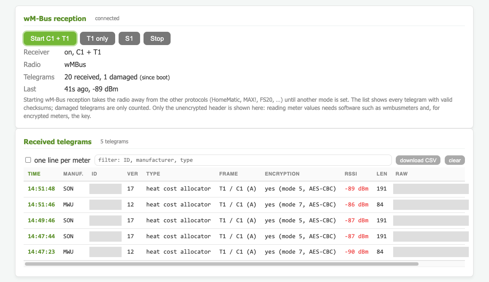

# CULFW32 — Wireless M-Bus guide

CULFW32 receives Wireless M-Bus telegrams (EN 13757-4) from meters in modes S1, T1 and C1 and prints every frame as a line of hex digits, as culfw does. It does not decrypt or decode telegrams; that is the job of host software such as wmbusmeters, FHEM (module `WMBUS`) or ioBroker (adapter `wireless-mbus`). The meter operator, for example the water utility, knows which mode a meter sends in and supplies its AES key.

---

## Commands

| Command | Effect | Answer |
|---|---|---|
| `brs` | receive mode S1 (868.30 MHz) | `SMODE` |
| `brt` | receive mode T1 (868.95 MHz) | `TMODE` |
| `brc` | receive modes C1 and T1 at the same time (868.95 MHz) | `CMODE` |
| `br` + any other letter, e.g. `brx` | receiver off | `OFF` |
| `b` | show the current mode | `SMODE`, `TMODE`, `CMODE` or `OFF` |
| `bss<hex>`, `bst<hex>` | send one frame in mode S or T, then go on receiving as before | current mode |

`bss` and `bst` take one frame in frame format A, starting with the L-field and including its CRC bytes. A command line holds 128 characters, so frames of up to 62 bytes (L-field up to 53) can be sent this way. CULFW32 does not transmit in mode C.

While wM-Bus reception is on, the radio receives no other protocol, as in culfw. `X21` then only sets the report flags and does not switch the radio back to SlowRF.

---

## Receive lines

```
b<frame><LQI><RSSI>      modes S1 and T1, and C1 in frame format A
bY<frame><LQI><RSSI>     mode C1 in frame format B
```

- `<frame>` holds every byte from the L-field to the last CRC byte, two hex digits each. Frames with a CRC error are not printed; `?stats` counts them in the `wmbus` line (`rx <ok>/<errors>`).
- `<LQI>` and `<RSSI>` are the two status bytes the CC1101 appends to a received packet (data sheet SWRS061I). The RSSI in dBm is roughly the RSSI byte as a signed number, divided by two, minus 74.

Frame format A carries a CRC after the first 10 bytes and after every further 16 bytes. In frame format B the L-field counts all following bytes including the CRCs; frames of up to 128 bytes have one CRC at the end, longer ones a CRC over bytes 0 to 125 and a second one at the end.

---

## Web UI

The tab *wM-Bus* of the web UI (`http://<stick-ip>`) starts reception with buttons for `brc`, `brt` and `brs` and lists every received telegram with manufacturer, ID, version, device type, frame, encryption, RSSI and the raw line, optionally one line per meter. It reads only the unencrypted header, so it answers whether a meter is in range before any host software is set up; readings need one of the decoders below. The log lives in the open browser page (up to 1000 telegrams); the CSV download keeps it.

- Starting a mode asks first if another protocol is using the radio, because wM-Bus reception stops it.
- Stop switches the receiver off and leaves the radio idle; it does not return to the protocol used before. Switch back from the host software, with `X21`, `Ar` or `Zr` in the Terminal tab, or by restarting the stick. The reception mode does not survive a restart either.
- Stop sends `brx` only after the stick has answered that wM-Bus is receiving, because `br` + any other letter first switches the radio to wM-Bus.
- In mode `brc` a `b…` line can be T1 or C1 in frame format A; the tab shows `T1 / C1 (A)`. Only `bY…` is certain (C1, frame format B).
- The error counter also counts noise that began like a telegram.
- In security modes 5 and 7 the tab shows how many 16-byte blocks are encrypted; with 0 blocks the telegram is plain text.



---

## wmbusmeters

wmbusmeters reads a CUL from a serial device. With the stick on USB:

```
wmbusmeters --format=json /dev/ttyACM0:cul:c1 MyWater <driver> <meter id> <AES key>
```

With `:cul:c1` wmbusmeters sends `brc` and expects `CMODE`; `:cul:t1` sends `brt`, `:cul:s1` sends `brs`. Verified on test hardware with wmbusmeters 3.1.1 in modes T1 and C1 (frame formats A and B), with OMS telegrams in security mode 5 and with the Kamstrup test telegram of the wmbusmeters test suite (driver `kamwater`, security mode 10).

Over the network (WiFi or Ethernet, TCP port 2323) wmbusmeters needs a serial device as well; `socat` provides one. Start it before wmbusmeters and keep it running:

```
socat pty,link=/tmp/ttyCUL32,raw,echo=0 tcp:<stick-ip>:2323
wmbusmeters --format=json /tmp/ttyCUL32:cul:c1 MyWater <driver> <meter id> <AES key>
```

This bridge was tested in mode T1.

The development version of wmbusmeters (after 3.1.1) runs `CMD(...)` in both directions and reaches the stick without socat; tested in modes C1 and T1:

```
wmbusmeters --format=json 'cul:c1:CMD(nc <stick-ip> 2323)' MyWater <driver> <meter id> <AES key>
```

---

## FHEM

Define the stick as a `CUL` device, on USB or as `<stick-ip>:2323`, and set its attribute `rfmode` to `WMBus_S`, `WMBus_T` or `WMBus_C`. FHEM then sends `X21` followed by `brs`, `brt` or `brc` (`00_CUL.pm`). The module `WMBUS` decodes the frames and takes the key in its attribute `AESkey`; it reads lines starting with `bY` as frame format B (`36_WMBUS.pm`).

Two limits on the FHEM side: in `00_CUL.pm` the `WMBus_C` branch checks for `brt` instead of `brc`, so a direct change from `WMBus_T` to `WMBus_C` has no effect — set `rfmode` to `SlowRF` in between. `CUL_Parse` filters the answers `SMODE` and `TMODE`, but not `CMODE`.

---

## Reception

In lab tests with generated frames, telegrams with a short preamble — 19 pairs of `01` chips before the sync word, the minimum EN 13757-4 sets for T1 — arrived less often (about four out of five) than telegrams with 64 pairs (nearly all), in modes T1 and C1 alike. Meters send their readings again and again, so a lost telegram is followed by the next one.
